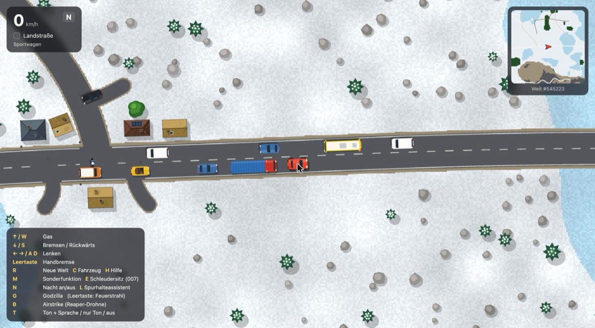
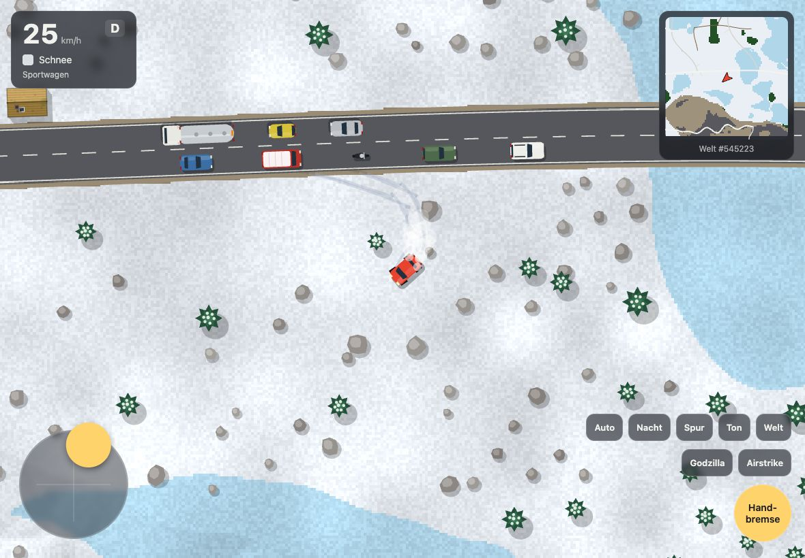
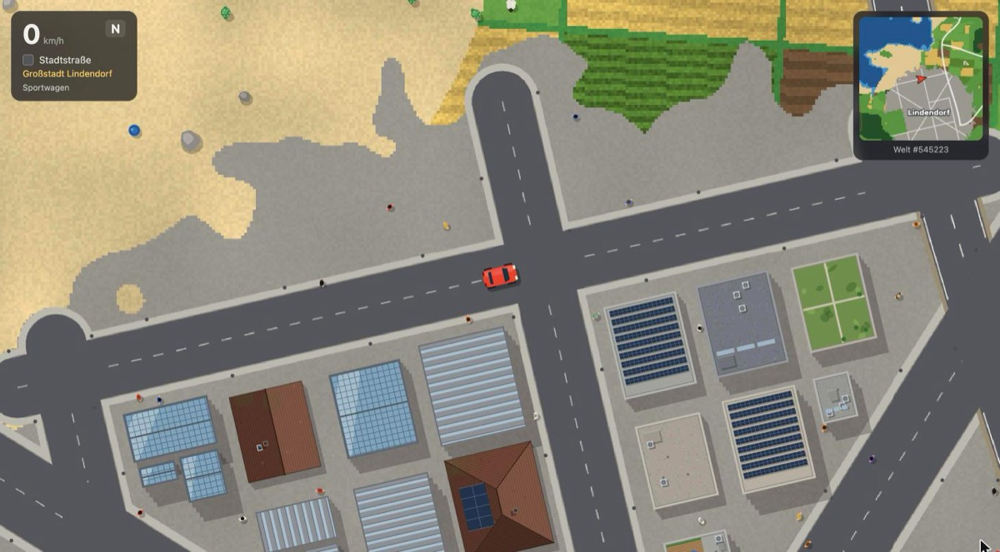
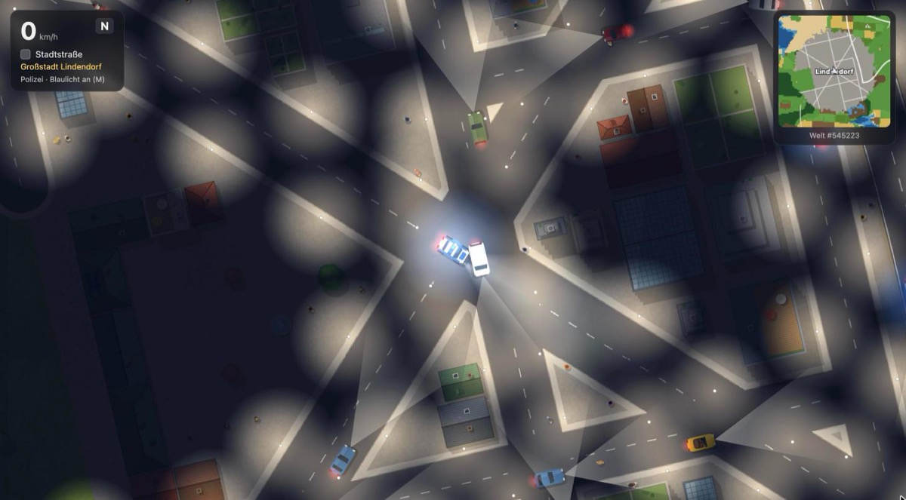
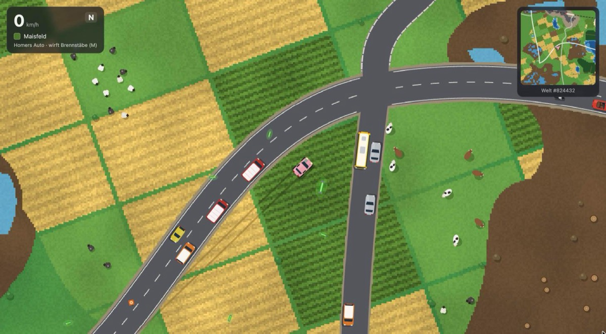
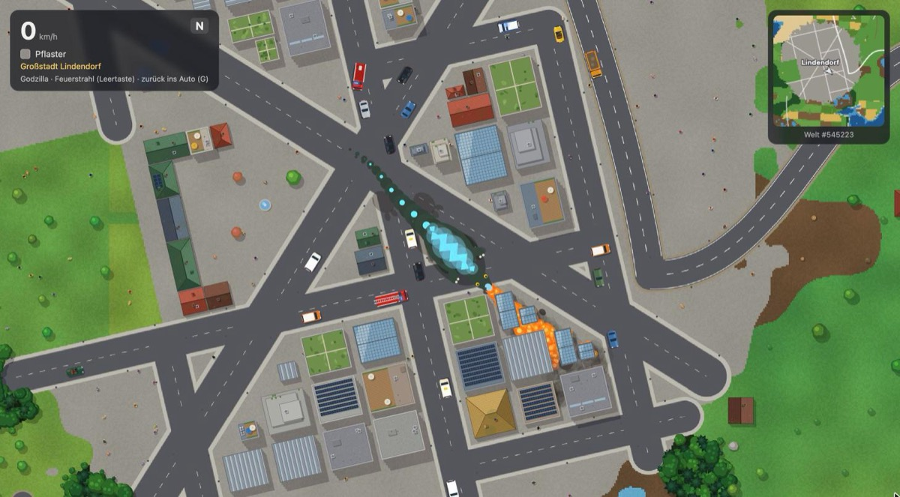
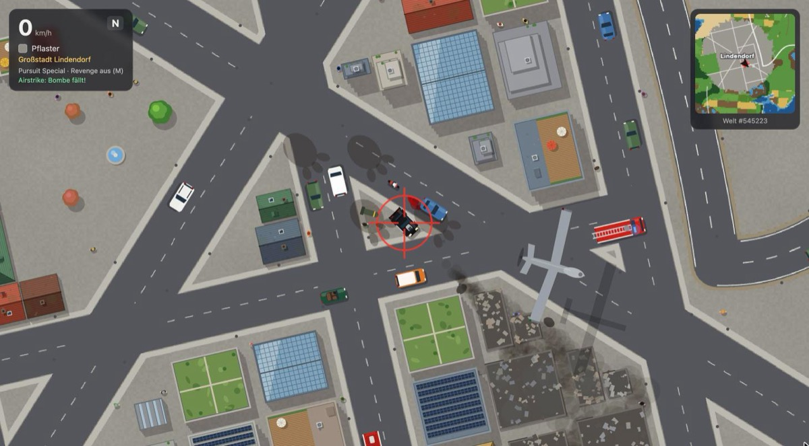
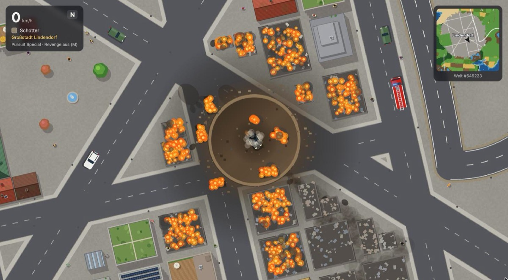
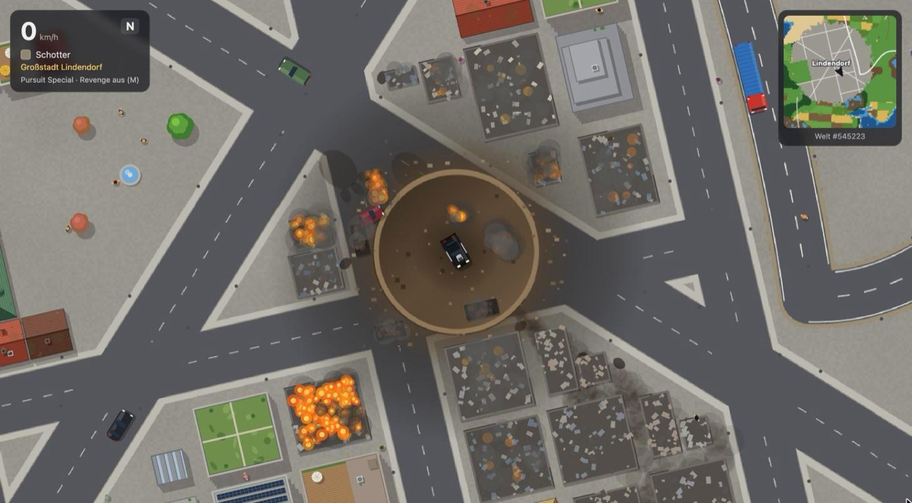

# Car Game

[Play in Browser](https://mkrgr.github.io/cargame/)

Ein Top-down-Autospiel im Browser mit einer endlosen, prozedural erzeugten Welt: Landstraßen, Städte und Dörfer, Wälder, Gebirge, Flüsse, Bahnlinien, Verkehr, Fußgänger und Tiere – dazu acht Fahrzeuge mit Sonderfunktionen, Godzilla und Luftschläge.

## Starten

`index.html` im Browser öffnen – fertig. Das Spiel ist eine einzige HTML-Datei ohne Build-Schritt und ohne Abhängigkeiten. Es lädt **keine externen Ressourcen** (keine Skripte, keine Webfonts, keine Audiodateien): Grafik wird auf dem Canvas gezeichnet, Töne werden mit WebAudio synthetisiert, und die Sprachausgabe nutzt ausschließlich lokal installierte Stimmen des Systems.

Jede Welt hat eine Nummer (unten in der Karte). Über den URL-Hash lässt sich eine Welt gezielt laden, z. B. `index.html#545223`.

## Steuerung

| Taste | Funktion |
|---|---|
| ↑ / W | Gas |
| ↓ / S | Bremsen / Rückwärts |
| ← → / A D | Lenken |
| Leertaste | Handbremse (als Godzilla: Feuerstrahl) |
| C | Fahrzeug wechseln |
| M | Sonderfunktion des Fahrzeugs |
| E | Schleudersitz (007) |
| L | Spurhalteassistent |
| N | Nacht an/aus |
| G | Godzilla |
| B | Airstrike (Reaper-Drohne) |
| T | Ton + Sprache / nur Ton / aus |
| R | Neue Welt |
| H | Hilfe ein-/ausblenden |

### iPad und Touch

Auf Touch-Geräten erscheint automatisch eine Bildschirmsteuerung:

- **Stick links unten:** nach oben Gas geben (stufenlos), nach unten bremsen bzw. rückwärts fahren, seitlich stufenlos lenken.
- **Knöpfe rechts unten:** Handbremse (halten; als Godzilla: Feuer), Spezial (Sonderfunktion), darüber Auto, Nacht, Spur, Ton, Welt, Godzilla, Airstrike und – nur beim 007 – Sitz (Schleudersitz).

Stick und Knöpfe lassen sich gleichzeitig benutzen, z. B. Gas geben und dabei die Handbremse ziehen. Ton und Sprache starten nach der ersten Berührung.

## Fahrzeuge

| Fahrzeug | Sonderfunktion (M) |
|---|---|
| Sportwagen | – |
| Polizei | Blaulicht und Sirene |
| 007 | Maschinengewehre; Schleudersitz mit E |
| KITT | Turbo-Booster: Sprung über alles hinweg |
| DeLorean | Brennende Reifenspuren ab 88 km/h |
| A-Team-Van | Ausfahrender Geschützturm |
| Homers Auto | Wirft radioaktive Brennstäbe – wer sie berührt, wird zum Zombie |
| Pursuit Special | Revenge-Modus: Flammen aus den Seitenrohren, überfährt alles |

## Welt

- Endlose Welt aus Chunks: Wiesen, Felder, Wälder, Gebirge, Seen, Flüsse mit Brücken, Schnee- und Wüstenregionen
- Straßennetz mit Landstraßen, Gebirgsstraßen, Feldwegen, Unterführungen und Bahnübergängen mit Schranken
- Großstädte, Kleinstädte und Dörfer mit Häusern, Dächern, Plätzen und Straßenlaternen
- Verkehr (Pkw, Lkw, Busse, Taxis, Motorräder, Polizei, Feuerwehr), Züge, Fußgänger, Schafe und Kühe
- Unterschiedliche Bodenhaftung je Untergrund, Reifenspuren, Partikel
- Nachtmodus mit Scheinwerfern, Straßenbeleuchtung und Blaulicht
- Minikarte mit Ortsnamen

## Godzilla

Mit **G** wird man zu Godzilla: Jeder Schritt zertrampelt Häuser, Bäume und Fahrzeuge, die Leertaste speit einen Feuerstrahl, der alles in Brand setzt.

## Airstrike

**B** fordert einen Luftschlag auf die aktuelle Position an. Nach einigen Sekunden überfliegt eine Reaper-Drohne den Ort und klinkt eine Bombe aus. Die Explosion verwüstet die Umgebung und hinterlässt einen Krater, in den man hinein- und wieder herausfahren kann.

| Anflug | Explosion | Krater |
|---|---|---|
|  |  |  |

## Ton und Sprache

Alle Geräusche werden im Browser synthetisiert: Motor (je Fahrzeug eigener Klang, mit Schaltstufen), Reifenquietschen, Aufprall, Sirenen, Schüsse, Explosionen, Godzillas Brüllen, Zugsignal, Bahnübergang, Schafe und Kühe.

Dazu kommen gelegentliche englische Sprüche über die Sprachausgabe des Systems – z. B. Polizeifunk mit Rauschen, „D'oh!“ bei Homers Kollisionen, KITT, 007 oder der Reaper-Funk. Mit **T** lässt sich zwischen Ton + Sprache, nur Ton und stumm umschalten. Welche Stimmen verfügbar sind, hängt vom Betriebssystem ab; ist keine lokale englische Stimme installiert, bleibt die Sprache stumm.
